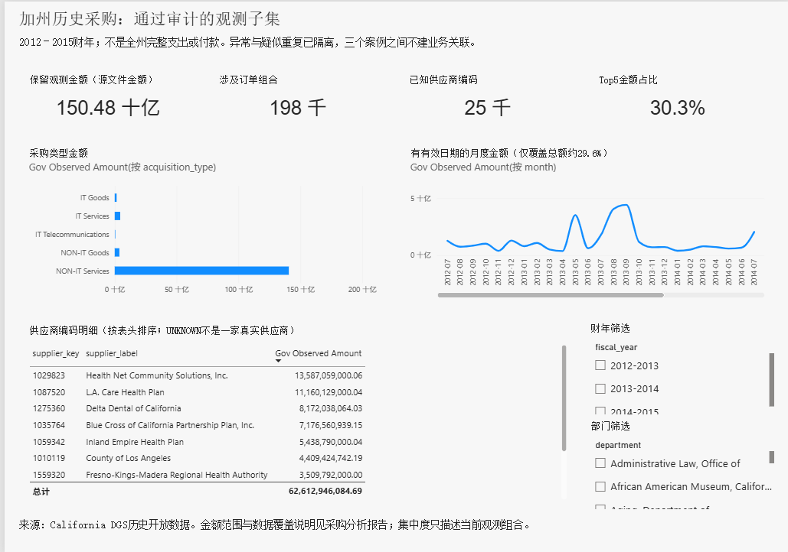
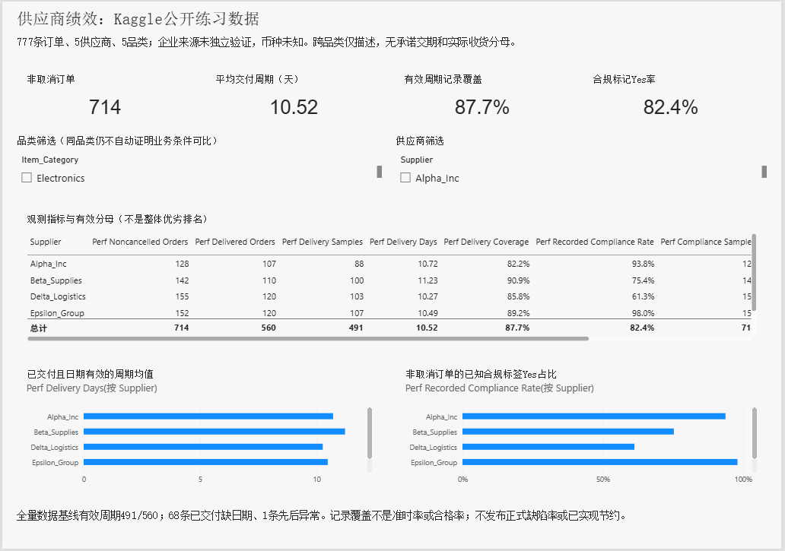
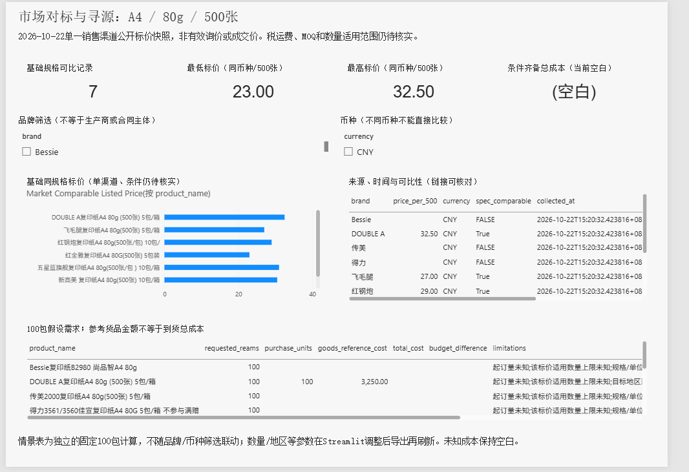

# Procurement Intelligence

采购支出、供应商绩效与市场报价分析项目。使用 Python、DuckDB SQL、Streamlit 和 Power BI，完成数据审计、指标核对、交互分析与采购情景测算。

## 分析内容

| 模块 | 数据与方法 | 结果 |
|---|---|---|
| 历史采购支出 | California DGS 2012–2015财年记录，异常隔离、订单组合键、ABC与集中度 | 344,504行原始记录，保留335,550条观测；198,343个订单组合 |
| 供应商绩效 | 777条公开练习订单，按供应商和品类计算周期、覆盖率与合规标签 | 25组指标；714条非取消订单，周期均值10.52天 |
| 供应商评分 | 单品类准入、min-max标准化、可调权重和敏感性分析 | 3种偏好假设下，4/5品类首位发生变化 |
| 市场对标 | 10条可追溯公开标价，包装与规格标准化 | 7条基础规格可比，23.00–32.50CNY/500张 |
| 决策工具 | CSV/XLSX读取、输入校验、筛选、权重与数量参数、CSV导出 | Streamlit四个视图；CSV上传流程已实测 |
| Power BI | 原生三页，10表、6条单向关系、26个度量值 | 33项数值、25个分组及Top10金额与Python核对一致 |

三个数据域对应独立案例，不拼接为同一家企业。订单金额不等于付款，标价不等于到货总成本，评分假设不等于正式供应商排名。

## Power BI

[原生项目](dashboard/powerbi/ProcurementIntelligence.pbip) · [模型与刷新说明](dashboard/powerbi/README.md) · [验证记录](docs/validation.md)







## 运行

本项目在 Python 3.13.5 和 Power BI Desktop 2.159.883.0 环境验证。

```powershell
git clone https://github.com/Linkchenwh/procurement-intelligence.git
cd procurement-intelligence
python -m venv .venv
.\.venv\Scripts\python.exe -m pip install -r requirements-lock.txt
.\.venv\Scripts\python.exe -m pytest -q
.\.venv\Scripts\python.exe -m streamlit run app.py
```

打开 `http://127.0.0.1:8501`。原始文件和本地缓存不入库；完整数据分析与看板刷新按[数据获取](docs/data_sources.md)和[运行说明](docs/implementation_guide.md)恢复。无数据时界面提示所需来源，不自动用合成数据替代正式结果。

## 结果与说明

- [历史采购分析](reports/procurement_report.md)
- [供应商绩效分析](reports/supplier_performance_report.md)
- [市场标价分析](reports/market_benchmark_report.md)
- [采购决策案例](reports/sourcing_decision_case.md)
- [数据字典](docs/data_dictionary.md)、[数据模型](docs/data_model.md)、[KPI口径](docs/kpi_definitions.md)

## 适用边界

政府数据仅为通过审计的历史观测子集。Kaggle数据按公开练习数据使用，企业来源声明未独立证实，币种未知。缺承诺交期与收货分母，不计算准时率或正式缺陷率。市场价格来自单一渠道的2026-10-22快照，税运费、MOQ和数量适用范围未知时，总成本与正式排名保持空白。Power BI为固定100包情景展示，动态数量调整在Streamlit。

测试数据仅用于测试。CSV上传已验证，有效XLSX完整浏览器流程未单独实测。数据和依赖遵循各自来源条款，仓库未额外指定代码许可证。
